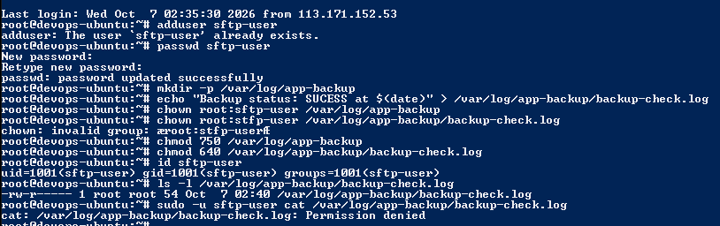
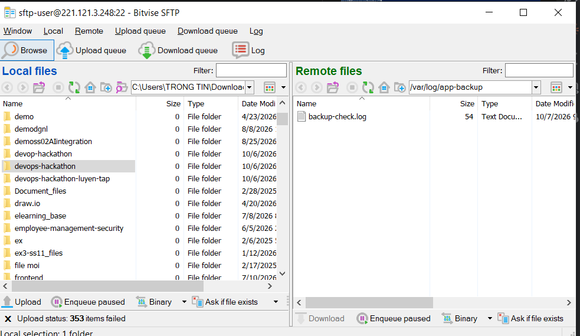

````markdown
# Bài 1: Quản lý người dùng giới hạn và truyền tải dữ liệu qua SFTP

## 1. Mục tiêu

- Tạo tài khoản `sftp-user` không thuộc nhóm `sudo`.
- Cấp quyền đọc file log cho tài khoản này.
- Tải file log từ máy chủ Ubuntu về Windows bằng SFTP.
- Kiểm tra nội dung file sau khi tải.

## 2. Môi trường

- Máy tính cá nhân: Windows 10.
- Máy chủ: Ubuntu 22.04.5 LTS.
- Công cụ nhập lệnh từ Windows: PowerShell kết nối SSH.
- Phần mềm truyền file: Bitvise SSH Client.

## 3. Tạo tài khoản

Thực hiện:

```bash
adduser sftp-user
```

Máy chủ thông báo tài khoản đã tồn tại:

```text
adduser: The user `sftp-user' already exists.
```

Đặt lại mật khẩu:

```bash
passwd sftp-user
```

Kết quả:

```text
passwd: password updated successfully
```

Không công khai mật khẩu trong báo cáo.

## 4. Tạo file log và cấp quyền

Các lệnh sử dụng:

```bash
mkdir -p /var/log/app-backup
echo "Backup status: SUCCESS at $(date)" > /var/log/app-backup/backup-check.log
chown root:sftp-user /var/log/app-backup
chown root:sftp-user /var/log/app-backup/backup-check.log
chmod 750 /var/log/app-backup
chmod 640 /var/log/app-backup/backup-check.log
```

Ý nghĩa:

- Chủ sở hữu là `root`, nhóm là `sftp-user`.
- Thư mục có quyền `750`: nhóm được đọc và truy cập.
- File có quyền `640`: nhóm được đọc nhưng không được sửa.

### Lỗi gặp phải và cách khắc phục

Ban đầu gõ nhầm:

```bash
chown root:stfp-user /var/log/app-backup/backup-check.log
```

Máy chủ báo:

```text
chown: invalid group: ‘root:stfp-user’
```

File vẫn thuộc nhóm `root`, khiến `sftp-user` đọc file bị `Permission denied`.

Lệnh sửa:

```bash
chown root:sftp-user /var/log/app-backup/backup-check.log
```

## 5. Kiểm tra tài khoản và quyền file

Chạy:

```bash
id sftp-user
ls -l /var/log/app-backup/backup-check.log
sudo -u sftp-user cat /var/log/app-backup/backup-check.log
```

Kết quả tài khoản đã ghi nhận:

```text
uid=1001(sftp-user) gid=1001(sftp-user) groups=1001(sftp-user)
```

Tài khoản không thuộc nhóm `sudo`.

Sau khi sửa, cần kiểm tra:

- Quyền file là `-rw-r-----`.
- Chủ sở hữu là `root`, nhóm là `sftp-user`.
- Tài khoản `sftp-user` đọc được nội dung log.

**Trạng thái:** Chưa bổ sung kết quả kiểm tra sau khi sửa quyền.



## 6. Tải file về Windows qua SFTP

Thực hiện trên Bitvise SSH Client:

1. Nhập IP VPS vào ô Host và cổng SSH vào ô Port.
2. Nhập Username là `sftp-user`.
3. Chọn phương thức đăng nhập `password`.
4. Nhập mật khẩu của `sftp-user`, nhấn Log in.
5. Sau khi kết nối, mở New SFTP Window.
6. Khung Remote bên phải: mở `/var/log/app-backup/`.
7. Khung Local bên trái: chọn thư mục lưu trên Windows.
8. Kéo `backup-check.log` từ khung Remote sang khung Local.

**Trạng thái:** Chưa bổ sung bằng chứng tải file thành công.


## 7. Kiểm tra nội dung trên Windows

Mở file `backup-check.log` đã tải về bằng Notepad.

Đối chiếu nội dung và thời gian với kết quả lệnh:

```bash
sudo -u sftp-user cat /var/log/app-backup/backup-check.log
```

Nội dung cần có dạng:

```text
Backup status: SUCCESS at <thời gian tạo file>
```

**Trạng thái:** Chưa bổ sung kết quả đối chiếu trên Windows.


## 8. Các file nộp bài

Đường dẫn: `homework/session_07/ex1/`

- `README.md`
- `kiem-tra.png`
- `sftp.png`
- `log-windows.png`

Bổ sung ảnh thực tế và cập nhật kết quả trước khi nộp.
````